# 📖 Kubernetes Architecture, Objects & CRDs: The Definitive "What, Why, How" Manual

Welcome to the comprehensive reference manual for the **Kubernetes Lab**. This guide breaks down **every single Kubernetes component, object, and Custom Resource Definition (CRD)** found in this repository using a structured **What, Why, How** framework, accompanied by **Mermaid architectural diagrams** and **official documentation links from `kubernetes.io`** and CNCF project manuals.

- 🟢 **What:** Clear, concise architectural definition of the object.
- 🟡 **Why:** The concrete problem it solves, real-world use cases, and trade-offs versus alternatives.
- 🔵 **How:** Internal mechanics (how the control plane and node agents reconcile it), key YAML fields, and command workflows.
- 🌐 **Official Manuals:** Direct links to the authoritative `kubernetes.io` documentation.

---

## 📑 Table of Contents

1. [Cluster Architecture & Control Plane Foundations](#1-cluster-architecture--control-plane-foundations)
2. [Namespaces, Multi-Tenancy & Resource Boundaries](#2-namespaces-multi-tenancy--resource-boundaries)
   - [Namespace](#namespace)
   - [ResourceQuota](#resourcequota)
   - [LimitRange](#limitrange)
3. [Pods & Container Lifecycle](#3-pods--container-lifecycle)
   - [Pod (Single Container)](#pod-single-container)
   - [Multi-Container Pod (Sidecar Pattern)](#multi-container-pod-sidecar-pattern)
   - [Init Containers](#init-containers)
   - [Health Probes & Lifecycle Hooks](#health-probes--lifecycle-hooks)
4. [Workload Controllers](#4-workload-controllers)
   - [ReplicaSet](#replicaset)
   - [Deployment (RollingUpdate & Recreate)](#deployment-rollingupdate--recreate)
   - [StatefulSet](#statefulset)
   - [DaemonSet](#daemonset)
   - [Job](#job)
   - [CronJob](#cronjob)
5. [Configuration & Secrets Management](#5-configuration--secrets-management)
   - [ConfigMap](#configmap)
   - [Secret (Opaque & TLS)](#secret-opaque--tls)
6. [Services & Core Networking](#6-services--core-networking)
   - [Service: ClusterIP](#service-clusterip)
   - [Service: NodePort](#service-nodeport)
   - [Service: LoadBalancer](#service-loadbalancer)
   - [Service: Headless](#service-headless)
   - [Service: ExternalName](#service-externalname)
   - [Ingress](#ingress)
   - [NetworkPolicy](#networkpolicy)
7. [Persistent Storage](#7-persistent-storage)
   - [StorageClass](#storageclass)
   - [PersistentVolume (PV)](#persistentvolume-pv)
   - [PersistentVolumeClaim (PVC)](#persistentvolumeclaim-pvc)
8. [Identity, Security & RBAC](#8-identity-security--rbac)
   - [ServiceAccount](#serviceaccount)
   - [Role & RoleBinding](#role--rolebinding)
   - [ClusterRole & ClusterRoleBinding](#clusterrole--clusterrolebinding)
9. [Autoscaling & High Availability](#9-autoscaling--high-availability)
   - [HorizontalPodAutoscaler (HPA v2)](#horizontalpodautoscaler-hpa-v2)
   - [PodDisruptionBudget (PDB)](#poddisruptionbudget-pdb)
10. [Advanced Node Scheduling & Placement](#10-advanced-node-scheduling--placement)
    - [nodeSelector](#nodeselector)
    - [Node Affinity & Anti-Affinity](#node-affinity--anti-affinity)
    - [Pod Affinity & Pod Anti-Affinity](#pod-affinity--pod-anti-affinity)
    - [Taints and Tolerations](#taints-and-tolerations)
    - [Topology Spread Constraints](#topology-spread-constraints)
11. [API Extensibility & CRDs](#11-api-extensibility--crds)
    - [CustomResourceDefinition (CRD) & Custom Resources](#customresourcedefinition-crd--custom-resources)
12. [Modern Kubernetes Gateway API](#12-modern-kubernetes-gateway-api)
    - [GatewayClass](#gatewayclass)
    - [Gateway](#gateway)
    - [HTTPRoute](#httproute)
    - [GRPCRoute](#grpcroute)
    - [TCPRoute & TLSRoute](#tcproute--tlsroute)
    - [ReferenceGrant](#referencegrant)
13. [Service Mesh (Istio & Envoy CRDs)](#13-service-mesh-istio--envoy-crds)
    - [VirtualService](#virtualservice)
    - [DestinationRule](#destinationrule)
    - [Istio Gateway](#istio-gateway)
    - [ServiceEntry](#serviceentry)
    - [PeerAuthentication](#peerauthentication)
    - [AuthorizationPolicy](#authorizationpolicy)
    - [Sidecar CRD](#sidecar-crd)
    - [EnvoyFilter](#envoyfilter)
    - [Telemetry CRD](#telemetry-crd)
14. [Full-Stack Observability](#14-full-stack-observability)
    - [Metrics Server & APIService (`metrics.k8s.io`)](#metrics-server--apiservice-metricsk8sio)
    - [ServiceMonitor & PodMonitor](#servicemonitor--podmonitor)
    - [PrometheusRule & AlertmanagerConfig](#prometheusrule--alertmanagerconfig)
    - [Prometheus Instance CRD](#prometheus-instance-crd)
    - [OpenTelemetry Collector & Auto-Instrumentation](#opentelemetry-collector--auto-instrumentation)
    - [Jaeger Distributed Tracing](#jaeger-distributed-tracing)
    - [Grafana Dashboard CRD](#grafana-dashboard-crd)
15. [Decision Matrix: Which Object Should You Use?](#15-decision-matrix-which-object-should-you-use)

---

## 1. Cluster Architecture & Control Plane Foundations

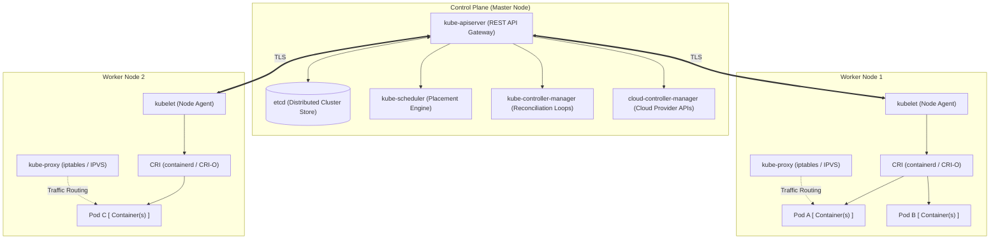

- **`kube-apiserver`**: The front door of the cluster. Every `kubectl` command, controller loop, and node communicates exclusively via REST APIs with the API server. Validates and configures data for API objects.
- **`etcd`**: Consistent, distributed, highly available key-value store holding the entire state of the cluster.
- **`kube-scheduler`**: Watches for newly created Pods with no assigned node and selects the healthiest, most suitable worker node based on resource constraints, affinity, taints, and topology.
- **`kube-controller-manager`**: Runs continuous control reconciliation loops (Node Lifecycle, Deployment, ReplicaSet, EndpointSlice, ServiceAccount controllers).
- **`kubelet`**: The agent running on each worker node. Ensures that containers described in PodSpecs are running and healthy.
- **`kube-proxy`**: Maintains network rules on nodes (via iptables or IPVS) to implement Service virtual IP routing.
- **`CRI` (Container Runtime Interface)**: Executes containers (e.g. `containerd`, `CRI-O`).
- **`CNI` (Container Network Interface)**: Provisions IP addresses and routes pod-to-pod networking (e.g. `Calico`, `Cilium`, `Flannel`).
- **`CSI` (Container Storage Interface)**: Attaches and mounts persistent block/file storage into pods.

🌐 **Official Manuals:**
- [Kubernetes Cluster Architecture Components](https://kubernetes.io/docs/concepts/overview/components/)
- [Kubernetes Architecture Deep-Dive](https://kubernetes.io/docs/concepts/architecture/)

---

## 2. Namespaces, Multi-Tenancy & Resource Boundaries

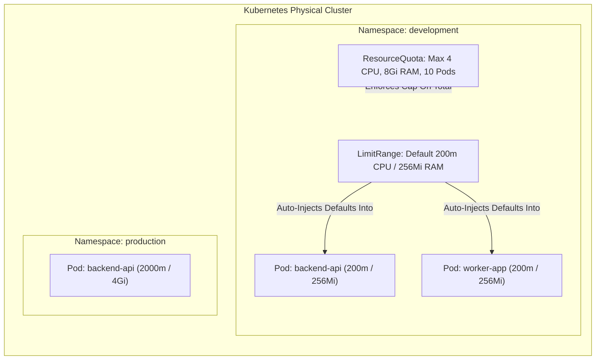

### Namespace
* **🟢 What:** A virtual cluster abstraction that partitions cluster resources between teams, environments (dev/stage/prod), or projects within a single physical cluster.
* **🟡 Why:** Without namespaces, naming collisions occur (only one pod named `web-server` could exist in the entire cluster), RBAC security policies cannot be scoped per team, and one team could consume all cluster resources.
* **🔵 How:**
  - Scopes names of namespaced resources (Pods, Deployments, Services, ConfigMaps). Cluster-scoped resources (Nodes, PVs, StorageClasses, Namespaces themselves) exist outside namespaces.
  - Pod Security Standards (PSA) are enforced at the namespace level using labels like `pod-security.kubernetes.io/enforce: baseline`.
  - DNS resolution within the same namespace uses `<service-name>`, while cross-namespace communication requires `<service-name>.<namespace>.svc.cluster.local`.
* **🌐 Official Manual:** [Kubernetes Namespaces Guide](https://kubernetes.io/docs/concepts/overview/working-with-objects/namespaces/)

### ResourceQuota
* **🟢 What:** A policy object that enforces hard aggregate caps on compute (CPU/RAM), storage (PVC counts and gigabytes), and API object counts within a namespace.
* **🟡 Why:** Solves the **"noisy neighbor"** problem. Prevents a buggy script or a single department from hogging all 1,000 CPU cores or allocating expensive cloud LoadBalancers without approval.
* **🔵 How:**
  - Intercepted by the `ResourceQuota` admission controller at object creation time.
  - If a namespace has compute quotas enabled (`requests.cpu`, `limits.memory`), **every single Pod** created in that namespace must explicitly define requests and limits; otherwise, the API server rejects pod creation immediately.
* **🌐 Official Manual:** [Kubernetes Resource Quotas](https://kubernetes.io/docs/concepts/policy/resource-quotas/)

### LimitRange
* **🟢 What:** A policy that enforces min/max boundaries and default resource sizes for individual containers and pods in a namespace.
* **🟡 Why:** While ResourceQuota limits the *sum total* of the whole namespace, LimitRange governs the *size of individual pods*. It prevents developers from deploying pods that ask for 0.0001m CPU (starvation) or 64 cores in a dev environment. Crucially, it **auto-injects default requests and limits** if omitted by developers, satisfying ResourceQuota requirements automatically!
* **🔵 How:**
  - Evaluated by the `LimitRanger` admission plugin before a pod is admitted to `etcd`.
  - Sets `default` (limit) and `defaultRequest` (request) per container.
* **🌐 Official Manual:** [Kubernetes Limit Ranges](https://kubernetes.io/docs/concepts/policy/limit-range/)

---

## 3. Pods & Container Lifecycle

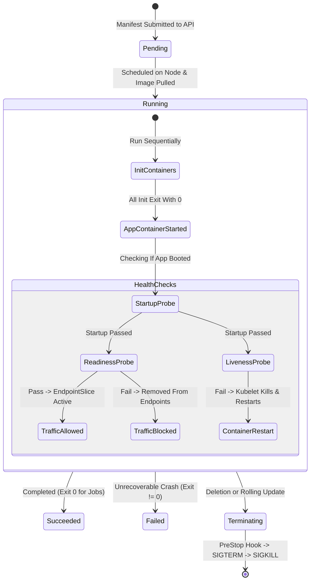

### Pod (Single Container)
* **🟢 What:** The atomic unit of deployment in Kubernetes. A wrapper around one or more closely coupled containers sharing network namespaces, IP addresses, IPC, and storage volumes.
* **🟡 Why:** Containers cannot be scheduled in isolation—they need a cohesive environment defining shared storage, loopback networking (`localhost`), and lifecycle constraints.
* **🔵 How:**
  - Kubelet calls the CRI to spin up an `infra/pause` container first, which sets up Linux namespaces (network, UTS, IPC). Subsequent containers join those shared namespaces.
  - Containers specify `requests` (used by kube-scheduler to find a node with enough room) and `limits` (enforced by Linux cgroups; CPU is throttled via CFS quota, memory exceeding limits triggers kernel `OOMKill`).
* **🌐 Official Manual:** [Kubernetes Pods](https://kubernetes.io/docs/concepts/workloads/pods/)

### Multi-Container Pod (Sidecar Pattern)
* **🟢 What:** A pod hosting two or more containers working cooperatively: a primary application container and one or more helper sidecars (e.g. log shipping, proxy, cache refresher).
* **🟡 Why:** Follows the Single Responsibility Principle. Rather than compiling logging, monitoring, and mutual TLS code into every application binary, a standardized sidecar container runs alongside the app and handles cross-cutting concerns.
* **🔵 How:**
  - Both containers mount a shared `emptyDir` volume. The main app writes logs to disk; the sidecar reads and streams them to Elasticsearch/CloudWatch.
  - Containers communicate over `localhost:<port>`.
* **🌐 Official Manual:** [Multi-Container Pods & Sidecar Containers](https://kubernetes.io/docs/concepts/workloads/pods/sidecar-containers/)

### Init Containers
* **🟢 What:** Specialized containers that run and complete to termination **before** any application containers start.
* **🟡 Why:** Applications frequently require prerequisites: waiting for a database to become reachable, downloading dynamic configurations, running database schema migrations, or setting Linux directory permissions (`chown`). Main app containers do not need admin tools (`nc`, `curl`, `git`) installed in their lean production images.
* **🔵 How:**
  - Executed sequentially in the exact order declared in `spec.initContainers`.
  - If an init container fails (non-zero exit code), Kubernetes restarts the Pod from the first init container until it succeeds (unless `restartPolicy: Never`). The app container never starts until all init containers exit with 0.
* **🌐 Official Manual:** [Init Containers Reference](https://kubernetes.io/docs/concepts/workloads/pods/init-containers/)

### Health Probes & Lifecycle Hooks
* **🟢 What:** Built-in health diagnostic mechanisms executed periodically by the Kubelet on each container.
* **🟡 Why:** Processes can freeze, deadlock, run out of database connections, or take minutes to warm up caches. Simple process-alive checks (`ps aux`) cannot detect an application stuck in an infinite loop.
* **🔵 How:**
  - **`startupProbe`**: Disables liveness and readiness checks until it passes. Gives slow-booting legacy apps a grace window (e.g. 5 minutes) without risking premature killing.
  - **`livenessProbe`**: Detects unrecoverable deadlocks. If it fails `failureThreshold` times, Kubelet kills the container and triggers a restart according to `restartPolicy`.
  - **`readinessProbe`**: Detects temporary overload. When it fails, the pod is NOT killed; instead, its IP is immediately pulled from matching Service Endpoints so no client traffic is routed to it.
  - **`preStop` hook**: A blocking command or HTTP call triggered immediately before a container is sent `SIGTERM`. Used to drain active connections, flush buffers, and finish inflight HTTP requests gracefully.
* **🌐 Official Manual:** [Configure Liveness, Readiness and Startup Probes](https://kubernetes.io/docs/tasks/configure-pod-container/configure-liveness-readiness-startup-probes/)

---

## 4. Workload Controllers

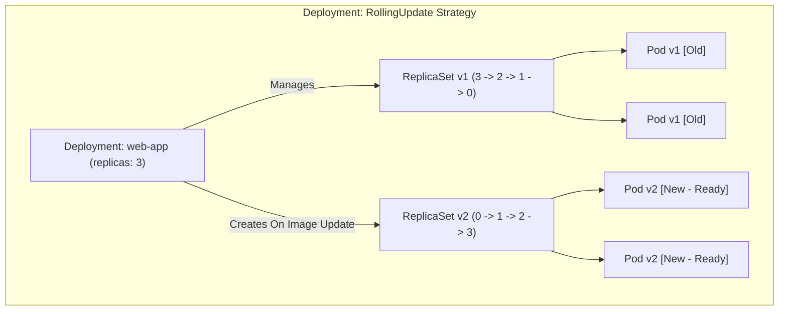

### ReplicaSet
* **🟢 What:** A controller whose sole duty is maintaining a stable number of identical running Pod replicas using label selectors.
* **🟡 Why:** Standalone Pods have no self-healing. If a node crashes, a standalone Pod dies forever. A ReplicaSet continuously reconciles desired replicas versus current replicas.
* **🔵 How:**
  - Runs a reconciliation loop: `Count(matching pods) < desired` -> create pod from template; `Count > desired` -> terminate excess pods.
  - Uses set-based selectors (`matchExpressions` with `In`, `NotIn`, `Exists`).
* **🌐 Official Manual:** [Kubernetes ReplicaSet](https://kubernetes.io/docs/concepts/workloads/controllers/replicaset/)

### Deployment (RollingUpdate & Recreate)
* **🟢 What:** Higher-level declarative controller that manages ReplicaSets, enabling zero-downtime rolling updates, rollbacks, and pause/resume functionality.
* **🟡 Why:** Modifying a ReplicaSet's container image does not update existing running pods. Deployments orchestrate the creation of a *new* ReplicaSet while gradually scaling down the *old* ReplicaSet, preventing outages.
* **🔵 How:**
  - **`RollingUpdate` strategy**: Uses `maxSurge` (how many extra pods can exist above desired replicas) and `maxUnavailable` (how many pods can be offline during the update). New pods must pass their `readinessProbe` before old pods are deleted!
  - **`Recreate` strategy**: Kills all existing pods simultaneously before creating new ones. Incurs downtime, but essential when two versions of an application cannot run concurrently (e.g., exclusive database lock or non-backward-compatible schema changes).
  - Maintains a rollout history (`revisionHistoryLimit`). Running `kubectl rollout undo deployment/<name>` instantly points traffic back to the previous ReplicaSet.
* **🌐 Official Manual:** [Kubernetes Deployments](https://kubernetes.io/docs/concepts/workloads/controllers/deployment/)

### StatefulSet
* **🟢 What:** Workload controller tailored for stateful applications requiring unique, persistent identities and dedicated persistent storage (e.g. MongoDB, Kafka, PostgreSQL, Elasticsearch).
* **🟡 Why:** Deployments treat pods as interchangeable cattle (`web-7f89-abc`). If `pod-1` dies, `pod-2` has no memory of what `pod-1` was doing. Distributed databases need deterministic network identity (`kafka-0`, `kafka-1`), ordered startup/shutdown, and dedicated disks that survive rescheduling.
* **🔵 How:**
  - **Deterministic Naming**: Pods are named sequentially (`<statefulset-name>-0`, `-1`, `-2`).
  - **Headless Service**: Paired with `clusterIP: None` Service to provide stable DNS records per pod (`kafka-0.kafka-headless.default.svc.cluster.local`).
  - **`volumeClaimTemplates`**: Automatically generates a dedicated, unique `PersistentVolumeClaim` for each replica (`data-kafka-0`, `data-kafka-1`). If `kafka-0` is rescheduled to another node, it reattaches `data-kafka-0`!
  - **Ordered Operations**: Scales up `0 -> 1 -> 2` waiting for each to become ready; scales down in reverse `2 -> 1 -> 0`.
* **🌐 Official Manual:** [Kubernetes StatefulSets](https://kubernetes.io/docs/concepts/workloads/controllers/statefulset/)

### DaemonSet
* **🟢 What:** A controller ensuring that **all (or filtered) worker nodes** run exactly one copy of a Pod.
* **🟡 Why:** Certain services must exist on every physical node: log forwarding agents (FluentBit, Promtail), infrastructure monitors (Prometheus Node Exporter, Datadog), and CNI networking pods (Calico, Kube-Proxy).
* **🔵 How:**
  - Kube-scheduler binds daemon pods directly to nodes as new nodes join the cluster.
  - Uses `tolerations` to run on control-plane/master nodes that normal pods cannot schedule on.
  - Mounts node host paths (`hostPath: /var/log`) to collect system-level metrics.
* **🌐 Official Manual:** [Kubernetes DaemonSets](https://kubernetes.io/docs/concepts/workloads/controllers/daemonset/)

### Job
* **🟢 What:** A controller that runs Pods to completion (exit code 0) rather than keeping them running continuously.
* **🟡 Why:** Deployments restart containers that exit. Batch processing, database migrations, machine learning training runs, and backups are finite tasks that *should* terminate when finished.
* **🔵 How:**
  - Enforces `restartPolicy: OnFailure` or `Never`.
  - Supports `completions` (total successes required) and `parallelism` (how many pods run concurrently).
  - Automatically cleans up finished pods using `ttlSecondsAfterFinished`.
* **🌐 Official Manual:** [Kubernetes Jobs](https://kubernetes.io/docs/concepts/workloads/controllers/job/)

### CronJob
* **🟢 What:** A time-based Job controller executing batch Jobs on a repeating schedule using standard 5-field Cron syntax.
* **🟡 Why:** Eliminates the need for external cron servers to run recurring tasks like nightly database backups, hourly cache warming, or weekly invoice generation.
* **🔵 How:**
  - Polls cluster time (supports standard time zones via `timeZone: "Etc/UTC"`).
  - Concurrency Policies:
    * `Allow`: New scheduled job runs even if the previous one is still executing.
    * `Forbid`: Skips the new run if the old one is still active (prevents overlapping database backups!).
    * `Replace`: Cancels the active job and starts the new one.
* **🌐 Official Manual:** [Kubernetes CronJobs](https://kubernetes.io/docs/concepts/workloads/controllers/cron-jobs/)

---

## 5. Configuration & Secrets Management

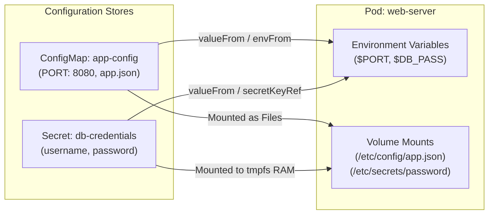

### ConfigMap
* **🟢 What:** An API object storing non-confidential configuration in key-value pairs or complete configuration files.
* **🟡 Why:** **The Twelve-Factor App Principle**: Strictly separate configuration from container code. Build the container image once; inject different configurations for dev, staging, and production.
* **🔵 How:**
  - Consumed in three ways:
    1. Single environment variable via `valueFrom.configMapKeyRef`.
    2. Bulk environment variables via `envFrom.configMapRef`.
    3. Mounted as read-only files in a directory via `volumes.configMap`. When mounted as a volume, Kubernetes automatically updates files in the container when the ConfigMap is modified (via symbolic link swapping)!
* **🌐 Official Manual:** [Kubernetes ConfigMaps](https://kubernetes.io/docs/concepts/configuration/configmap/)

### Secret (Opaque & TLS)
* **🟢 What:** An API object designed to store sensitive data (passwords, tokens, private keys, TLS certificates).
* **🟡 Why:** Prevents credentials from being checked into Git, baked into Docker images, or visible in plain pod specifications.
* **🔵 How:**
  - **Base64 vs Encryption:** Storing values in `data` requires Base64 encoding. *Base64 is obfuscation, not encryption!* Real security requires enabling **Encryption at Rest** in `kube-apiserver` so `etcd` encrypts secret data.
  - **Memory-backed tmpfs:** When mounted into a pod as a volume, secrets are written to RAM (`tmpfs`), never to the worker node's physical hard disk.
  - **`kubernetes.io/tls`**: Structured secret requiring `tls.crt` and `tls.key` for HTTPS termination on Ingress or Gateways.
* **🌐 Official Manual:** [Kubernetes Secrets](https://kubernetes.io/docs/concepts/configuration/secret/)

### External Secrets Operator (SecretStore & ExternalSecret)
* **🟢 What:** Kubernetes operator that integrates external secret management systems (AWS Secrets Manager, HashiCorp Vault, GCP Secret Manager, Azure Key Vault) directly into the Kubernetes cluster.
* **🟡 Why:** **The Enterprise GitOps Standard**: Committing raw Secret manifests (even Base64) to Git violates SOC2 and ISO 27001 compliance. ESO allows developers to commit purely declarative `ExternalSecret` manifests to Git while actual credentials reside securely in cloud vaults and are injected dynamically into etcd.
* **🔵 How:**
  - `SecretStore` authenticates via cloud IAM Workload Identity (AWS IRSA / GCP Workload Identity) without static API keys.
  - `ExternalSecret` defines which remote keys to pull and how to synthesize the resulting native Kubernetes `Secret`. It continuously polls and auto-rotates credentials when DBAs rotate passwords in the vault!
* **🌐 Official Manual:** [External Secrets Operator Documentation](https://external-secrets.io/)

### Cert-Manager (ClusterIssuer & Certificate)
* **🟢 What:** Cloud-native automated X.509 certificate management controller for Kubernetes.
* **🟡 Why:** Manual SSL certificate management causes severe outages when certificates inevitably expire. Cert-manager automates ordering, issuing, validating, and renewing TLS certificates from public (Let's Encrypt) and private (Vault, internal CA) issuers.
* **🔵 How:**
  - `ClusterIssuer` configures ACME challenge solvers (HTTP-01 via Ingress or DNS-01 via Route53/Cloudflare).
  - `Certificate` custom resource requests certificates for specific domain SANs and writes the resulting public cert and private key into a native `kubernetes.io/tls` Secret. It automatically renews certificates 30 days before the 90-day expiration window!
* **🌐 Official Manual:** [Cert-Manager Documentation](https://cert-manager.io/docs/)

---

## 6. Services & Core Networking

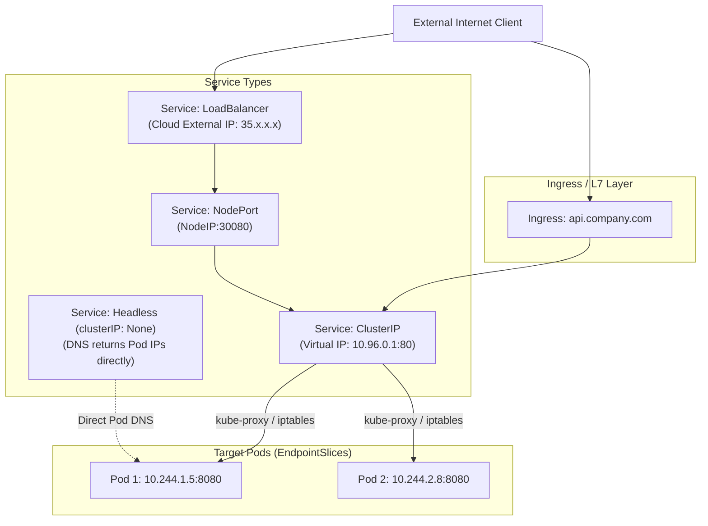

### Service: ClusterIP
* **🟢 What:** The default Kubernetes Service. Assigns a stable, cluster-internal Virtual IP (VIP) load-balancing traffic across matching pods.
* **🟡 Why:** Pods are ephemeral; their IPs change constantly upon restart or rescheduling. ClusterIP provides an immutable internal IP and DNS name (`backend-service.default.svc.cluster.local`).
* **🔵 How:**
  - Endpoints Controller tracks healthy pods matching `spec.selector` into `EndpointSlice` objects.
  - `kube-proxy` configures Linux `iptables` or `IPVS` rules on every node. Packets sent to the VIP are NATed directly to healthy pod IPs.
* **🌐 Official Manual:** [Kubernetes Services](https://kubernetes.io/docs/concepts/services-networking/service/)

### Service: NodePort
* **🟢 What:** Exposes a service externally by opening a dedicated static port (30000–32767) on **every worker node's IP**.
* **🟡 Why:** Enables basic external access without paying for a cloud load balancer. Ideal for bare-metal clusters, on-premise environments, or local labs.
* **🔵 How:**
  - Traffic flow: `Client -> <Any Node IP>:<NodePort> -> ClusterIP -> Pod IP`.
  - `externalTrafficPolicy: Local` preserves client source IP and avoids extra network hops between nodes, but drops packets if the contacted node hosts no local pod.
* **🌐 Official Manual:** [Service NodePort Details](https://kubernetes.io/docs/concepts/services-networking/service/#type-nodeport)

### Service: LoadBalancer
* **🟢 What:** Integrates with the underlying cloud provider (AWS, GCP, Azure, OpenStack) to provision an external cloud load balancer pointing to the service.
* **🟡 Why:** Production standard for internet-facing workloads. Provides a public IP, DDoS mitigation, and global traffic routing.
* **🔵 How:**
  - Cloud Controller Manager detects `type: LoadBalancer`, calls cloud provider APIs (e.g. AWS ELB/NLB), and maps incoming public traffic to worker node NodePorts or directly to Pod IPs.
* **🌐 Official Manual:** [Service LoadBalancer Details](https://kubernetes.io/docs/concepts/services-networking/service/#loadbalancer)

### Service: Headless
* **🟢 What:** A Service with `clusterIP: None` that allocates no virtual IP and does not perform load balancing.
* **🟡 Why:** Essential for StatefulSets and peer-to-peer discovery (Cassandra, Elasticsearch, ZooKeeper). Clients need direct IP addresses of individual cluster members rather than a random round-robin proxy.
* **🔵 How:**
  - DNS query for a headless service returns an `A` record containing the direct IP addresses of all backing pods.
* **🌐 Official Manual:** [Headless Services](https://kubernetes.io/docs/concepts/services-networking/service/#headless-services)

### Service: ExternalName
* **🟢 What:** A Service that maps an internal Kubernetes DNS name to an external DNS CNAME (e.g. `db.us-east-1.rds.amazonaws.com`).
* **🟡 Why:** Decouples applications from external infrastructure. Pods connect to `my-database`; if the external database endpoint changes, update only the ExternalName manifest without redeploying 50 microservices.
* **🔵 How:**
  - Pure DNS redirection handled by CoreDNS; no proxies or iptables rules are involved.
* **🌐 Official Manual:** [Service ExternalName](https://kubernetes.io/docs/concepts/services-networking/service/#externalname)

### Ingress
* **🟢 What:** A Layer 7 (HTTP/HTTPS) reverse proxy and router exposing routes from outside the cluster to internal Services.
* **🟡 Why:** Creating a `LoadBalancer` Service for every single microservice is cost-prohibitive (10 microservices = 10 cloud load balancers = hundreds of dollars/month). A single Ingress Controller routes traffic to dozens of services based on domain name and URL path using one public IP.
* **🔵 How:**
  - Ingress resource defines rules (`host: api.example.com`, `path: /v1`).
  - An Ingress Controller (e.g. `ingress-nginx`) watches Ingress objects and dynamically regenerates proxy routing configurations.
* **🌐 Official Manual:** [Kubernetes Ingress Guide](https://kubernetes.io/docs/concepts/services-networking/ingress/)

### NetworkPolicy
* **🟢 What:** A declarative Layer 3/4 firewall specifying which pods can communicate with each other, other namespaces, and external CIDR blocks.
* **🟡 Why:** By default, Kubernetes networking is completely flat and open: **any pod can talk to any other pod across any namespace**. NetworkPolicy enforces **Zero Trust** security (e.g., frontend can talk to backend, but frontend can never talk directly to the database).
* **🔵 How:**
  - Requires a network CNI plugin that supports policy enforcement (e.g. `Calico`, `Cilium`). Flannel alone does NOT enforce NetworkPolicies!
  - Employs a **default-deny** model: once a pod is selected by a policy, all unwhitelisted traffic is dropped by kernel packet filters (`iptables` or eBPF).
* **🌐 Official Manual:** [Kubernetes Network Policies](https://kubernetes.io/docs/concepts/services-networking/network-policies/)

---

## 7. Persistent Storage

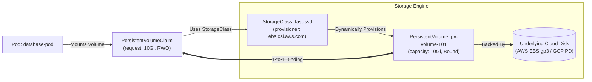

### StorageClass
* **🟢 What:** An administrative profile defining the "class" of storage offered (e.g., fast SSD vs cheap HDD) and the dynamic volume provisioner plugin.
* **🟡 Why:** Eliminates manual volume provisioning. Developers request storage on-demand without needing cluster admins to pre-create disks.
* **🔵 How:**
  - `volumeBindingMode: WaitForFirstConsumer` delays physical disk creation until a Pod using the PVC is scheduled. This ensures the cloud disk is provisioned in the **exact same Availability Zone** as the worker node hosting the pod!
* **🌐 Official Manual:** [Kubernetes Storage Classes](https://kubernetes.io/docs/concepts/storage/storage-classes/)

### PersistentVolume (PV)
* **🟢 What:** A cluster-scoped storage resource representing a physical piece of storage (AWS EBS, GCP PD, NFS, local disk).
* **🟡 Why:** Container filesystems are ephemeral; when a container crashes, changes are lost. PVs have lifecycles independent of any pod.
* **🔵 How:**
  - Created statically by admins or dynamically via StorageClasses.
  - Reclaim Policies: `Delete` (deletes cloud disk when PVC is deleted) vs `Retain` (preserves physical data for manual recovery).
* **🌐 Official Manual:** [Persistent Volumes](https://kubernetes.io/docs/concepts/storage/persistent-volumes/)

### PersistentVolumeClaim (PVC)
* **🟢 What:** A namespace-scoped user request for storage (e.g., "Give me 10Gi with ReadWriteOnce access").
* **🟡 Why:** Pod authors do not need to know cloud-specific volume IDs or SAN configurations. PVCs abstract storage consumption the same way Pods abstract compute consumption.
* **🔵 How:**
  - Control plane matches PVC storage size and access modes (`ReadWriteOnce`, `ReadOnlyMany`, `ReadWriteMany`) to a compatible PV and forms a 1-to-1 binding.
* **🌐 Official Manual:** [PersistentVolumeClaims](https://kubernetes.io/docs/concepts/storage/persistent-volumes/#persistentvolumeclaims)

---

## 8. Identity, Security & RBAC

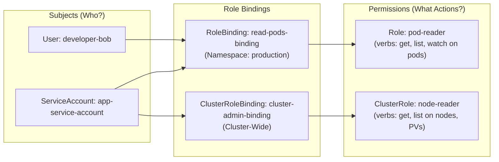

### ServiceAccount
* **🟢 What:** An in-cluster cryptographic identity for processes running inside Pods.
* **🟡 Why:** Human users authenticate via OIDC/SSO. Applications inside pods (client libraries, operators, CI/CD runners) need their own scoped credentials to authenticate with the Kubernetes API server.
* **🔵 How:**
  - Token Projected Volume automatically mounts an ephemeral, auto-rotating JWT token at `/var/run/secrets/kubernetes.io/serviceaccount/token`.
  - Can be mapped to cloud IAM roles (AWS IRSA, GCP Workload Identity) via annotations.
* **🌐 Official Manual:** [Managing Service Accounts](https://kubernetes.io/docs/concepts/security/service-accounts/)

### Role & RoleBinding
* **🟢 What:** 
  - **Role:** A namespace-scoped list of permissions (allowed API groups, resources, and verbs like `get`, `list`, `create`).
  - **RoleBinding:** Binds a Role to specific subjects (Users, Groups, ServiceAccounts) within that namespace.
* **🟡 Why:** Enforces the Principle of Least Privilege. Prevents developers or service accounts in namespace `dev` from reading or deleting resources in `prod`.
* **🔵 How:**
  - RBAC is purely **additive** (no "deny" rules). If no matching Role grants a verb on a resource, the API server returns HTTP 403 Forbidden.
* **🌐 Official Manual:** [RBAC Authorization: Roles and RoleBindings](https://kubernetes.io/docs/reference/access-authn-authz/rbac/#role-and-clusterrole)

### ClusterRole & ClusterRoleBinding
* **🟢 What:**
  - **ClusterRole:** A cluster-wide permission set for cluster-scoped resources (Nodes, PVs, Namespaces) or reusable namespaced permission templates.
  - **ClusterRoleBinding:** Grants permissions across **all namespaces** cluster-wide.
* **🟡 Why:** Node-level monitoring daemons, security scanners, and cluster administrators require access to resources that do not belong to any single namespace.
* **🔵 How:**
  - *Pro-Tip:* Binding a `ClusterRole` using a standard `RoleBinding` grants those permissions *only within that one specific namespace* (reusable role template pattern).
* **🌐 Official Manual:** [RBAC ClusterRole and ClusterRoleBinding](https://kubernetes.io/docs/reference/access-authn-authz/rbac/#clusterrole-and-clusterrolebinding)

---

## 9. Autoscaling & High Availability

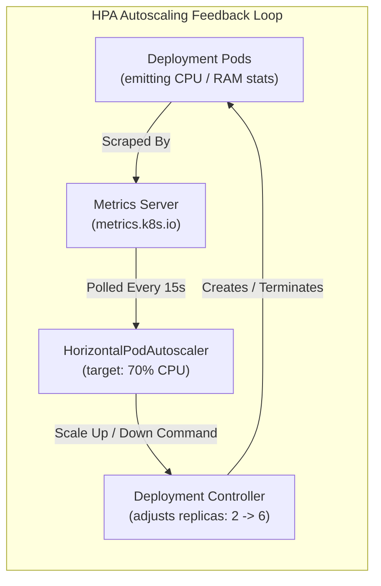

### HorizontalPodAutoscaler (HPA v2)
* **🟢 What:** A controller that automatically adjusts the number of Pod replicas in a Deployment or StatefulSet based on observed CPU, memory, or custom metrics.
* **🟡 Why:** Handles traffic surges during peak business hours and saves cloud infrastructure costs by scaling down during quiet nights.
* **🔵 How:**
  - Queries `metrics.k8s.io` (Metrics Server) or Prometheus Adapter every 15 seconds.
  - Scaling Algorithm: `desiredReplicas = ceil[currentReplicas * (currentMetric / targetMetric)]`.
  - Configures `behavior` stabilization windows (e.g. scale down over 5 minutes) to prevent metric flapping.
* **🌐 Official Manual:** [Horizontal Pod Autoscaling](https://kubernetes.io/docs/tasks/run-application/horizontal-pod-autoscale/)

### PodDisruptionBudget (PDB)
* **🟢 What:** A high-availability policy limiting the number of pods that can be offline simultaneously during **voluntary disruptions**.
* **🟡 Why:** Hardware crashes are involuntary. But node drains (`kubectl drain`), cluster OS upgrades, and cloud node auto-scaling downscales are voluntary. Without a PDB, draining a node could terminate all replicas of a service simultaneously, causing an outage.
* **🔵 How:**
  - Configures `minAvailable: 2` or `maxUnavailable: 25%`.
  - The Eviction API checks matching PDBs before evicting a pod; if evicting violates the budget, the eviction is rejected until replacement pods are healthy.
* **🌐 Official Manual:** [Specifying a Disruption Budget](https://kubernetes.io/docs/tasks/run-application/configure-pdb/)

---

## 10. Advanced Node Scheduling & Placement

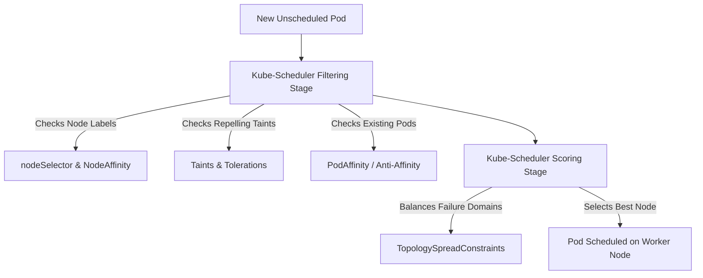

### nodeSelector
* **🟢 What:** Simple key-value equality filter that pins a pod to worker nodes carrying matching labels.
* **🟡 Why:** Fastest way to schedule workloads onto dedicated nodes (e.g., `disktype: ssd` or `gpu: true`).
* **🔵 How:** Kube-scheduler filters out any node whose labels do not match all `nodeSelector` entries.
* **🌐 Official Manual:** [Assigning Pods to Nodes: nodeSelector](https://kubernetes.io/docs/concepts/scheduling-eviction/assign-pod-node/#nodeselector)

### Node Affinity & Anti-Affinity
* **🟢 What:** Advanced, expressive node placement rules with boolean operators and weighted soft preferences.
* **🟡 Why:** `nodeSelector` only supports exact matching. Node Affinity allows `In`, `NotIn`, `Exists`, and allows **soft preferences** ("try to run on compute-optimized nodes, but run elsewhere if full").
* **🔵 How:**
  - `requiredDuringSchedulingIgnoredDuringExecution`: Hard requirement; pod stays Pending if no node matches.
  - `preferredDuringSchedulingIgnoredDuringExecution`: Soft requirement; scheduler scores matching nodes with weights (1–100).
* **🌐 Official Manual:** [Node Affinity Documentation](https://kubernetes.io/docs/concepts/scheduling-eviction/assign-pod-node/#node-affinity)

### Pod Affinity & Pod Anti-Affinity
* **🟢 What:** Rules that place pods relative to **other pods** based on labels on existing running pods.
* **🟡 Why:**
  - **Pod Affinity (Co-location):** Place web frontend pods in the same availability zone as Redis cache pods to minimize network latency.
  - **Pod Anti-Affinity (Spreading):** Ensure two replicas of the same critical API never run on the same physical host or zone, guaranteeing high availability during a hardware failure.
* **🔵 How:**
  - Evaluated using `topologyKey` (e.g. `kubernetes.io/hostname` for per-node spread, or `topology.kubernetes.io/zone` for per-zone spread).
* **🌐 Official Manual:** [Inter-pod Affinity and Anti-affinity](https://kubernetes.io/docs/concepts/scheduling-eviction/assign-pod-node/#inter-pod-affinity-and-anti-affinity)

### Taints and Tolerations
* **🟢 What:**
  - **Taint:** Applied to a *node* to **repel** pods.
  - **Toleration:** Applied to a *pod* allowing it to run on tainted nodes.
* **🟡 Why:** Node Affinity *attracts* pods to nodes; Taints allow nodes to *reject* pods. Used to reserve dedicated GPU nodes for ML teams, or keep user workloads off control-plane nodes.
* **🔵 How:**
  - Taint Effects:
    * `NoSchedule`: Untolerating pods will never be placed on this node.
    * `PreferNoSchedule`: Scheduler avoids placing pods here if possible.
    * `NoExecute`: Untolerating pods already running on the node are **immediately evicted**!
* **🌐 Official Manual:** [Taints and Tolerations](https://kubernetes.io/docs/concepts/scheduling-eviction/taint-and-toleration/)

### Topology Spread Constraints
* **🟢 What:** Advanced scheduling rule that distributes pods evenly across failure domains (regions, zones, racks, nodes).
* **🟡 Why:** Pod Anti-Affinity is binary (either 1 pod per node or unlimited). Topology Spread allows smooth, balanced distribution (e.g. 10 pods across 3 zones such that no zone differs by more than 1 pod).
* **🔵 How:**
  - Calculates `skew = |pods in current domain - min pods across all domains|`. Enforces `maxSkew: 1`.
* **🌐 Official Manual:** [Pod Topology Spread Constraints](https://kubernetes.io/docs/concepts/scheduling-eviction/topology-spread-constraints/)

---

## 11. API Extensibility & CRDs

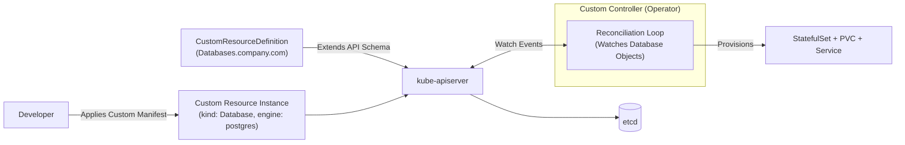

### CustomResourceDefinition (CRD) & Custom Resources
* **🟢 What:** A mechanism allowing users to extend the Kubernetes API with their own custom object types without modifying Kubernetes source code.
* **🟡 Why:** Turns Kubernetes into a universal control plane. Powers the **Operator Pattern**: pair a CRD (storing desired state) with a custom controller (active reconciliation loop) to manage complex systems like PostgreSQL clusters or Kafka automatically.
* **🔵 How:**
  - Defined in `apiextensions.k8s.io/v1`.
  - Schema is strictly validated via OpenAPI v3 specifications.
  - Supports `/status` subresources and custom `additionalPrinterColumns` for `kubectl get` displays.
* **🌐 Official Manuals:**
  - [Custom Resources Overview](https://kubernetes.io/docs/concepts/extend-kubernetes/api-extension/custom-resources/)
  - [Operator Pattern in Kubernetes](https://kubernetes.io/docs/concepts/extend-kubernetes/operator/)

---

## 12. Modern Kubernetes Gateway API

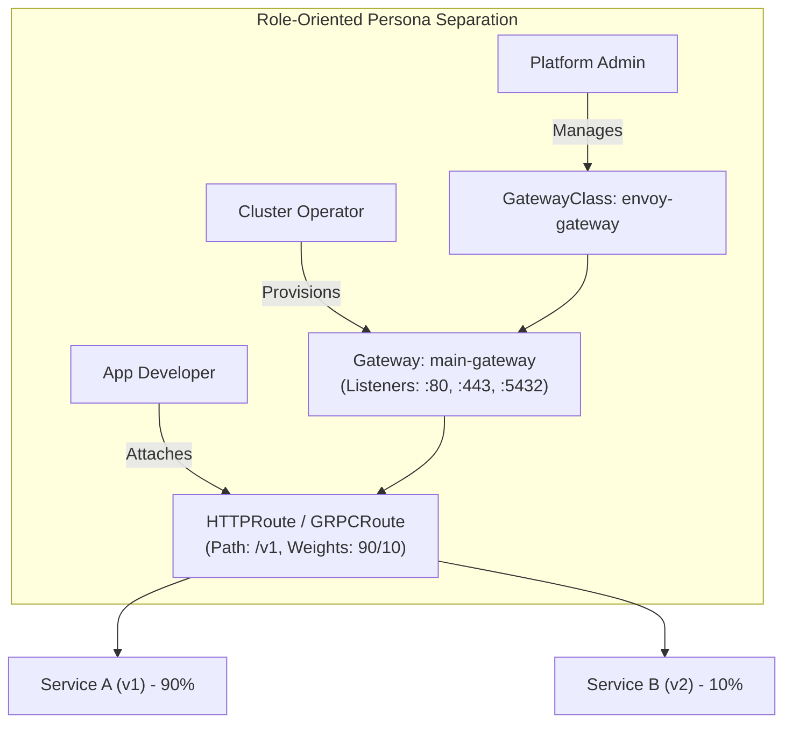

### GatewayClass
* **🟢 What:** Cluster-scoped template defining the controller implementation managing Gateways (e.g., Envoy Gateway, Istio, Cilium).
* **🟡 Why:** Separates infrastructure vendor selection (managed by platform admins) from daily traffic routing.

### Gateway
* **🟢 What:** The declarative definition of an edge proxy / load balancer instance, specifying ports, protocols (HTTP, HTTPS, TCP, TLS passthrough), hostnames, and TLS secrets.
* **🟡 Why:** Decouples listener provisioning from application routing rules, enabling true multi-tenant self-service.

### HTTPRoute
* **🟢 What:** Layer 7 HTTP routing resource attaching to Gateway listeners.
* **🟡 Why:** Replaces traditional Ingress. Natively supports canary traffic splitting (weights), header matching, query params, URL rewriting, request header modifications, and traffic mirroring.

### GRPCRoute
* **🟢 What:** Native routing resource for gRPC traffic matching on gRPC service and method names.
* **🟡 Why:** Eliminates fragile URL regex hacks previously required to route gRPC over HTTP/2.

### TCPRoute & TLSRoute
* **🟢 What:**
  - **TCPRoute:** Layer 4 forwarding for non-HTTP protocols (databases, Kafka).
  - **TLSRoute:** End-to-end encrypted TLS passthrough based on SNI (Server Name Indication) matching without decrypting at the edge.
* **🟡 Why:** Enables non-HTTP protocols and strict end-to-end encryption compliance.

### ReferenceGrant
* **🟢 What:** Cross-namespace security handshake mechanism for Gateway API.
* **🟡 Why:** By default, Gateways in namespace `infra` cannot reference Secrets or Services in namespace `app`. ReferenceGrant allows resource owners to explicitly permit cross-namespace attachment.
* **🌐 Official Manual:** [Kubernetes Gateway API Documentation](https://gateway-api.sigs.k8s.io/)

---

## 13. Service Mesh (Istio & Envoy CRDs)

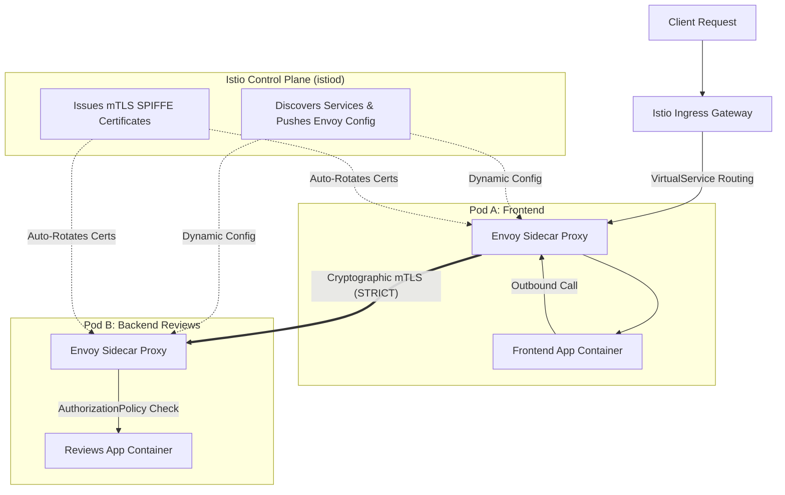

### VirtualService
* **🟢 What:** Istio traffic routing CRD defining how requests are addressed and routed to destinations.
* **🟡 Why:** Enables canary releases, A/B testing (matching on HTTP headers), fault injection (delays/aborts for chaos engineering), retries, and request timeouts.

### DestinationRule
* **🟢 What:** Defines policies applied to traffic *after* routing has occurred.
* **🟡 Why:** Configures client-side load balancing algorithms (`LEAST_CONN`, `ROUND_ROBIN`), connection pool limits, mutual TLS authentication modes, and **circuit breaking via outlier detection** (ejecting failing pods).

### Istio Gateway
* **🟢 What:** Configures an Envoy proxy running at the edge of the mesh to accept incoming external traffic.
* **🟡 Why:** Decouples port/TLS listener configuration from internal service routing logic.

### ServiceEntry
* **🟢 What:** Registers external, third-party services (outside the Kubernetes cluster) into the mesh's internal service registry.
* **🟡 Why:** Allows mesh features (timeouts, retries, distributed tracing, egress security policies) to apply to outbound SaaS API calls (e.g. Stripe, AWS S3).

### PeerAuthentication
* **🟢 What:** Enforces cryptographic Mutual TLS (mTLS) between Envoy sidecars across the mesh.
* **🟡 Why:** Upgrades cluster communication to zero-trust encryption with zero application code changes (`STRICT` mode blocks cleartext traffic).

### AuthorizationPolicy
* **🟢 What:** Declarative Layer 7 Zero-Trust access control engine.
* **🟡 Why:** While NetworkPolicy only filters on IP and Port, AuthorizationPolicy inspects client cryptographic SPIFFE identities, JWT tokens, HTTP methods, and URL paths.

### Sidecar CRD
* **🟢 What:** Configuration tuning resource that scopes the service discovery visibility of Envoy sidecars.
* **🟡 Why:** In massive clusters, pushing 1,000 service configs to every sidecar wastes hundreds of megabytes of memory per pod. Sidecar CRD slashes proxy memory from ~300MB down to ~20MB!

### EnvoyFilter
* **🟢 What:** Low-level mechanism to patch and customize the underlying Envoy proxy filter chain directly.
* **🟡 Why:** Enables power-user capabilities like running inline Lua scripts or loading WebAssembly (Wasm) filters.

### Telemetry CRD
* **🟢 What:** Workload-level observability tuning resource for tracing sampling rates, access log filtering, and metrics.
* **🟡 Why:** Allows reducing distributed trace sampling from 100% to 1% on heavy endpoints to save cloud storage and bandwidth costs.
* **🌐 Official Manuals:**
  - [Istio Official Concepts & Architecture](https://istio.io/latest/docs/concepts/)
  - [Istio Traffic Management](https://istio.io/latest/docs/concepts/traffic-management/)
  - [Istio Security & Zero Trust](https://istio.io/latest/docs/concepts/security/)

---

## 14. Full-Stack Observability

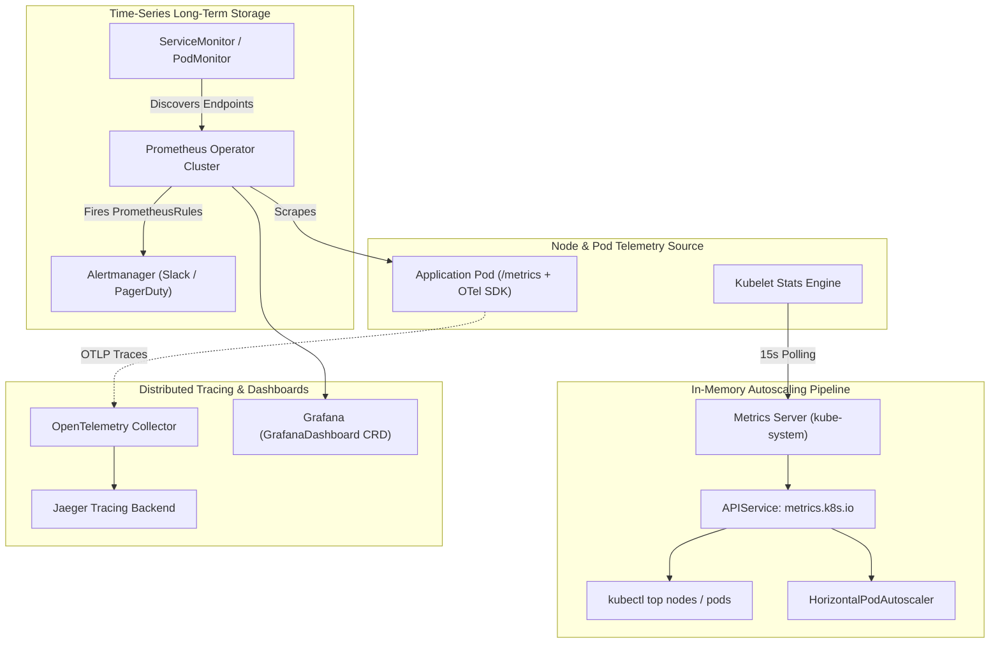

### Metrics Server & APIService (`metrics.k8s.io`)
* **🟢 What:** Lightweight, in-memory aggregator of CPU and memory utilization collected from node Kubelets.
* **🟡 Why:** Essential core component powering `kubectl top nodes`, `kubectl top pods`, and the Horizontal Pod Autoscaler (HPA).
* **🔵 How:**
  - Uses the **Aggregator API (`APIService`)** rather than a CRD. High-frequency in-memory metrics would destroy `etcd` if saved as standard custom resources. `APIService` proxies requests dynamically to the `metrics-server` pod.
* **🌐 Official Manuals:**
  - [Kubernetes Metrics Server Repository](https://github.com/kubernetes-sigs/metrics-server)
  - [API Server Aggregation in Kubernetes](https://kubernetes.io/docs/concepts/extend-kubernetes/api-extension/apiserver-aggregation/)

### ServiceMonitor & PodMonitor
* **🟢 What:** Prometheus Operator CRDs defining declarative metric scraping targets.
* **🟡 Why:** Eliminates manual editing and restarting of monolithic `prometheus.yml` files. Adding a microservice automatically registers its monitoring scrape target.
* **🔵 How:**
  - `ServiceMonitor` targets Kubernetes Services; `PodMonitor` targets Pods directly (ideal for DaemonSets and batch jobs).
* **🌐 Official Manual:** [Prometheus Operator Documentation](https://prometheus-operator.dev/)

### PrometheusRule & AlertmanagerConfig
* **🟢 What:** Declarative PromQL alerting/recording rules and namespace-scoped alert routing configurations.
* **🟡 Why:** Allows product teams to define alert rules and route notifications directly to their own Slack channels or PagerDuty schedules without touching global cluster configs.
* **🌐 Official Manual:** [Prometheus Operator Alerting Guide](https://prometheus-operator.dev/docs/user-guides/alerting/)

### Prometheus Instance CRD
* **🟢 What:** Deploys and manages a stateful, highly available Prometheus cluster via the Prometheus Operator.
* **🟡 Why:** Automates configuration generation, PVC volume attachment, retention management, and zero-downtime reloads.

### OpenTelemetry Collector & Auto-Instrumentation
* **🟢 What:** Vendor-neutral framework for processing traces, metrics, and logs, combined with zero-code auto-instrumentation injection.
* **🟡 Why:** Eliminates manual tracing code. Adding a simple annotation (`inject-java: "true"`) automatically mounts agents and exports distributed traces to any backend.
* **🌐 Official Manual:** [OpenTelemetry Operator for Kubernetes](https://opentelemetry.io/docs/kubernetes/operator/)

### Jaeger Distributed Tracing
* **🟢 What:** CNCF distributed tracing platform CRD managing all-in-one or production tracing infrastructure.
* **🟡 Why:** Visualizes request flow across microservices, identifying latency bottlenecks and root causes of failed transactions.
* **🌐 Official Manual:** [Jaeger Operator Documentation](https://www.jaegertracing.io/docs/)

### Grafana Dashboard CRD
* **🟢 What:** Declarative GitOps dashboard resource managed by the Grafana Operator.
* **🟡 Why:** Keeps dashboards as version-controlled code in Git, preventing accidental manual deletions and ensuring dashboard parity across environments.
* **🌐 Official Manual:** [Grafana Operator GitHub](https://grafana.github.io/grafana-operator/)

---

## 15. Decision Matrix: Which Object Should You Use?

| Workload / Use Case | Recommended Object | Documentation Reference |
|---|---|---|
| Stateless Web App / Microservice | `Deployment` + `Service (ClusterIP)` + `HTTPRoute / Ingress` | [Deployments Guide](https://kubernetes.io/docs/concepts/workloads/controllers/deployment/) |
| Stateful Database / Message Broker | `StatefulSet` + `Headless Service` + `volumeClaimTemplates` | [StatefulSets Guide](https://kubernetes.io/docs/concepts/workloads/controllers/statefulset/) |
| Per-Node Logging / Monitoring Agent | `DaemonSet` | [DaemonSets Guide](https://kubernetes.io/docs/concepts/workloads/controllers/daemonset/) |
| One-Off Database Migration / Script | `Job` | [Jobs Guide](https://kubernetes.io/docs/concepts/workloads/controllers/job/) |
| Nightly Backup / Scheduled Cleanup | `CronJob` | [CronJobs Guide](https://kubernetes.io/docs/concepts/workloads/controllers/cron-jobs/) |
| Dynamic Metric Scaling | `HorizontalPodAutoscaler` + `Metrics Server` | [HPA Guide](https://kubernetes.io/docs/tasks/run-application/horizontal-pod-autoscale/) |
| Zero-Downtime Node Maintenance | `PodDisruptionBudget` | [PDB Guide](https://kubernetes.io/docs/concepts/workloads/pods/disruptions/) |
| Multi-Zone High Availability | `TopologySpreadConstraints` + `PodAntiAffinity` | [Scheduling Guide](https://kubernetes.io/docs/concepts/scheduling-eviction/topology-spread-constraints/) |
| Cross-Service Mutual TLS & L7 Security | `PeerAuthentication` + `AuthorizationPolicy` | [Istio Security](https://istio.io/latest/docs/concepts/security/) |
| Declarative Prometheus Metrics Scraping | `ServiceMonitor` | [Prometheus Operator](https://prometheus-operator.dev/) |
